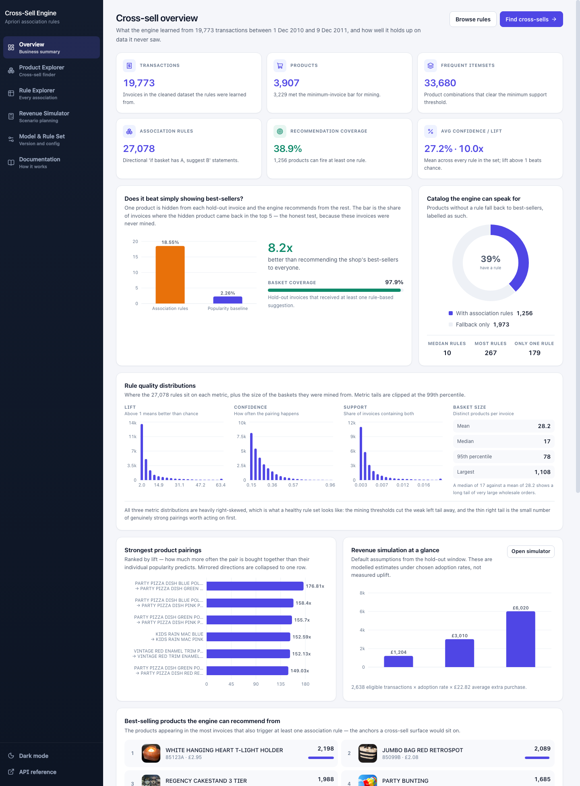
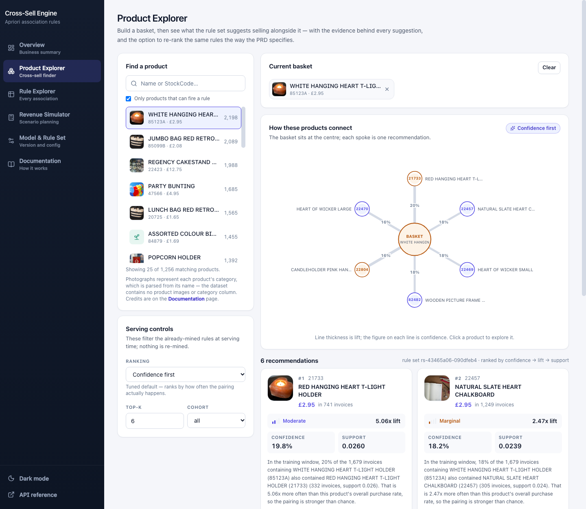

# E-Commerce Cross-Sell Recommendation Engine

Apriori association-rule mining over the **Online Retail** dataset, served as a
FastAPI REST API and explored through a React dashboard, with a revenue-impact
simulator, a reproducibility manifest, and a hold-out evaluation that is
measured rather than asserted.

> Built to the PRD *E-Commerce Cross-Sell Recommendation Engine* (Advanced Data
> Science track). Traceability from every FR/AC to the code and test that
> satisfies it is in [docs/PRD_TRACEABILITY.md](docs/PRD_TRACEABILITY.md).

---

## Results on the untouched hold-out split

| Metric | Value |
| --- | --- |
| Association rules | **27,078** (from 33,680 frequent itemsets) |
| Hit rate @5 | **0.1855** — the hidden product is recovered in the top 5 for 18.6% of hold-out baskets |
| Popularity baseline | 0.0226 — **8.2× uplift** over "just show best-sellers" |
| MRR @5 | 0.1229 |
| Basket coverage | 97.9% of hold-out baskets receive a rule-based answer |
| Catalog coverage | 38.9% of mineable products have at least one rule |
| Mining time | 2.6 s for 12,779 training baskets |

**How this is measured.** Invoices are split *chronologically* (70 / 15 / 15).
Rules are mined on the training window only; thresholds were tuned on the
validation window; the numbers above come from the final window, which the
miner never saw. For each hold-out basket one product is hidden with a fixed
seed, the engine recommends from the remaining products, and we check whether
the hidden product comes back. The popularity baseline runs the identical
replay while recommending the overall best-sellers — an association-rule engine
that cannot beat that is not earning its keep.

Full write-up with figures: **[reports/evaluation_report.md](reports/evaluation_report.md)**

---

## Quickstart

```bash
make setup     # virtualenv + Python deps + npm install
make data      # download Online Retail into data/raw/ (no credentials needed)
make train     # clean → baskets → Apriori → rules → evaluate → version
make report    # reports/evaluation_report.md + figures
make test      # 184 tests
```

The category photographs are committed, so there is nothing to fetch. `make
images` re-downloads them from Wikimedia Commons if you ever need to refresh
them; the dashboard falls back to icon tiles for any that are missing.

Then, in two terminals:

```bash
make api       # http://127.0.0.1:8000        (OpenAPI docs at /docs)
make ui        # http://localhost:5173
```

Requirements: Python ≥ 3.10 and Node ≥ 18. Verified on Python 3.14 / Node 26 with
pandas 3.1, numpy 2.5, mlxtend 0.25, FastAPI 0.163.

### The dataset

The brief links to Kaggle, which needs an account. `make data` instead fetches
the identical file from its original source, the UCI Machine Learning
Repository (`Online Retail.xlsx`, 541,909 rows, Dec 2010 – Dec 2011). To use a
Kaggle copy instead, drop it in `data/raw/` and point `paths.raw_data` at it —
the pipeline hashes whatever file it is given and records the digest in the
manifest, so a rule set can always be traced to the exact bytes behind it.

---

## The dashboard

A business-intelligence front end over the rule set, not a metrics readout.
Six screens, Vite + React + Tailwind + Recharts against the FastAPI backend
(`make api`, then `make ui`, then <http://localhost:5173>).



| Screen | What it is for |
|---|---|
| **Overview** | Headline KPIs with a one-line meaning each, engine-vs-baseline comparison, coverage donut, metric distributions, strongest pairings, and a feed of derived business insights |
| **Product Explorer** | Search the catalog, build a basket, and get ranked cross-sells as product cards with price, category, strength band, full evidence and an inspectable rule. Includes a radial association graph and a live ranking switch |
| **Rule Explorer** | All 27,078 rules: search, metric-threshold filters, sortable columns, strength indicators, pagination, a detail drawer and CSV export |
| **Revenue Simulator** | Three adoption scenarios as distinct cards, a comparison chart, the calculation broken down, and the simulated-not-measured disclaimer |
| **Model & Rule Set** | Version, thresholds, dataset hash, preprocessing policy, cleaning audit and the exact command to reproduce the rule set |
| **Documentation** | Apriori, itemsets and the three metrics explained against one worked example, plus the limitations |



**Design notes**

- Light theme by default (slate page, white cards, navy rail, indigo accent);
  a designed dark variant sits behind the toggle. Both chart palettes were
  checked with a CVD/contrast validator: light `#4f46e5 #e8710a #0f8a6a` on
  white, dark `#6b74e8 #d4762f #1f9b74` on `#131a2a`, all checks passing.
- Chart colours are resolved from the CSS custom properties in JavaScript and
  passed to Recharts as literal values. A CSS variable is not valid inside an
  SVG presentation attribute, and Safari and Firefox correctly ignore it —
  which previously left every chart blank in those browsers while the HTML
  tiles rendered fine.
- **Product imagery represents a category, not the product.** This is the one
  thing to understand before reading the screenshots. The Online Retail dataset
  is invoice lines: no images, no image URLs, no category column. Searching a
  photo library for the real product names returns *nothing* —
  `white hanging heart t-light holder`, `jumbo bag red retrospot` and
  `regency cakestand 3 tier` all return zero results, and loosening the query
  returns the wrong object (a polka-dot *purse* for a jumbo shopping bag).

  So each product shows one photograph chosen by hand to represent its derived
  category, and every surface that renders one says so. Products that could not
  be categorised show a neutral icon rather than a picture implying we know what
  they are. Prices are genuine (`median_unit_price` per StockCode).

  The images come from Wikimedia Commons under Public Domain, CC0, CC BY or
  CC BY-SA — none are non-commercial. Each is **pinned to an exact Commons file
  title**, so `make images` a year from now fetches the same images rather than
  whatever a search ranks first that day. They are downloaded once into
  `frontend/public/category-images/` with an `attribution.json` manifest and
  served from the app, so **opening the dashboard makes no request to any
  external host** (verified: zero non-localhost image requests across all six
  routes). Credits render on the Documentation screen, as the BY and BY-SA
  terms require.

  **9 of the 12 categories currently ship a photograph.** Commons rate-limited
  this machine partway through the initial fetch, so *Toys & Games*,
  *Garden & Outdoor* and *Home Decor* still fall back to their icon tiles.
  `make images` is idempotent — it keeps what is already downloaded and
  completes the rest once the limit clears.
- Responsive down to 390px: the rail becomes a slide-over and wide tables
  scroll inside their card. Verified with zero page-level overflow on all six
  routes.

A basket lives in the query string, so a set of recommendations can be shared
or bookmarked: `/products?basket=85123A,22423`.

## What the pipeline does

```
data/raw/Online Retail.xlsx            immutable input, sha256 into the manifest
  │
  ├─ 1 clean          documented policy, per-stage audit trail      541,909 → 522,537 rows (96.4%)
  ├─ 2 baskets        one invoice = one set of distinct products    19,773 invoices, 3,907 products
  ├─ 3 split          chronological 70/15/15                        12,779 / 2,686 / 2,695
  ├─ 4 eligibility    products with ≥5 training invoices            decided on train only
  ├─ 5 mine           Apriori on train                              33,680 itemsets → 27,078 rules
  ├─ 6 evaluate       leave-one-out replay on the hold-out          hit@5 0.1855 vs 0.0226
  ├─ 7 cohorts        separate rule sets, new vs repeat             6,663 / 5,617 rules
  └─ 8 persist        artifacts/<version>/ + manifest.json
```

### The cleaning policy

Every stage is configurable and every removed row is counted in
`cleaning_audit.csv`:

| Stage | Rows removed | Why |
| --- | --- | --- |
| exact duplicate rows | 5,268 | re-scans / export artefacts |
| cancellation invoices (`C` prefix) | 9,251 | not purchases |
| negative quantities | 1,336 | returns and corrections |
| zero unit prices | 1,176 | samples, adjustments, data errors |
| non-product service codes | 2,341 | `POST`, `DOT`, `M`, `BANK CHARGES`, `gift_*` … |

That last one matters more than it looks: postage co-occurs with almost
everything, so leaving it in produces high-support rules like *"buy X → buy
POST"* that are statistically strong and commercially worthless.

Returns and cancellations are excluded from the **baseline** baskets. That is a
modelling choice, not a cleanup: it is recorded in the audit and the raw rows
are untouched if you want a returns analysis.

---

## Using it

### CLI

```bash
python -m crosssell.cli train                  # mine, evaluate, version
python -m crosssell.cli tune                   # threshold sweep (validation only)
python -m crosssell.cli evaluate --split test  # re-evaluate the active rule set
python -m crosssell.cli report                 # markdown report + figures
python -m crosssell.cli recommend 85123A       # ad-hoc, in the terminal
python -m crosssell.cli info                   # which rule set is active?
python -m crosssell.cli serve                  # run the API
```

```
$ python -m crosssell.cli recommend 85123A

Basket      : 85123A (WHITE HANGING HEART T-LIGHT HOLDER)
Rule set    : rs-43465a06-090dfeb4

1. 21733     RED HANGING HEART T-LIGHT HOLDER    [association_rule]
   support=0.0260 confidence=0.198 lift=5.06
   In the training window, 20% of the 1,679 invoices containing WHITE HANGING HEART
   T-LIGHT HOLDER (85123A) also contained RED HANGING HEART T-LIGHT HOLDER (21733)
   (332 invoices, support 0.026). That is 5.06x more often than this product's
   overall purchase rate, so the pairing is stronger than chance.
```

### API

| Endpoint | Method | Purpose |
| --- | --- | --- |
| `/health` | GET | service status, active rule-set version |
| `/products` | GET | search/list the catalog (`search`, `only_with_rules`, paging) |
| `/products/{id}` | GET | one product |
| `/rules` | GET | browse rules (`product`, `role`, `min_*`, `sort_by`, `cohort`, paging) |
| `/recommendations/{id}` | GET | ranked cross-sell for one product (`rank_by` re-ranks) |
| `/recommendations` | POST | ranked cross-sell for a multi-product basket |
| `/simulate-revenue` | POST | scenario simulation from explicit assumptions |
| `/config` | GET | thresholds, dataset snapshot, environment, repro command |
| `/stats` | GET | dashboard KPIs and metric distributions |
| `/evaluation` | GET | hold-out results and the cleaning audit |
| `/insights` | GET | business insights derived from the active rule set |

```bash
curl 'http://127.0.0.1:8000/recommendations/85123A?top_k=3'

# the PRD's lift-first ordering, against the same mined rule set
curl 'http://127.0.0.1:8000/recommendations/85123A?rank_by=lift&rank_by=confidence&rank_by=support'

curl 'http://127.0.0.1:8000/insights'
curl -X POST http://127.0.0.1:8000/recommendations \
     -H 'Content-Type: application/json' \
     -d '{"products":["85123A","71053"],"top_k":5}'
curl -X POST http://127.0.0.1:8000/simulate-revenue \
     -H 'Content-Type: application/json' \
     -d '{"eligible_transactions":2638,"average_order_value":22.82}'
```

Unknown product ids return `404` with a hint; malformed simulation input returns
`422`. Optional `X-API-Key` auth is available by setting `api.api_key` in the
config or `$CROSSSELL_API_KEY` (off by default, `/health` stays open).

### Dashboard

Six screens, matching the PRD: **Overview** (KPIs, metric distributions,
engine-vs-baseline), **Product Explorer** (build a basket, see recommendations
with their evidence), **Rule Explorer** (sortable, filterable, CSV export),
**Revenue Simulator** (scenario comparison), **Model / Rule Set** (version,
thresholds, dataset snapshot, cleaning audit), **Documentation** (metrics,
architecture, limitations). Light and dark themes.

---

## Deployment (Render + Vercel)

The repository ships the trained rule set in `artifacts/rs-43465a06-090dfeb4/`
so the backend starts directly from CSV/JSON (~4s, ~116 MB RAM) without
downloading or parsing the 23 MB Excel source file on deploy.

1. **Backend on Render** (configured via [`render.yaml`](render.yaml)):
   - Create a **New Web Service** (or **Blueprint**) from this repo.
   - Build command: `pip install --upgrade pip && pip install -r requirements.txt && pip install --no-deps -e .`
   - Start command: `uvicorn crosssell.api.main:app --host 0.0.0.0 --port $PORT`
   - Health check path: `/health`
   - CORS env vars: `CROSSSELL_CORS_ORIGIN_REGEX=^https://.*\.vercel\.app$` (pre-configured in `render.yaml`), plus optional `CROSSSELL_CORS_ORIGINS` (comma-separated) for custom domains and `CROSSSELL_API_KEY` if you want `X-API-Key` auth.

2. **Frontend on Vercel** (configured via [`frontend/vercel.json`](frontend/vercel.json)):
   - Import the repo in Vercel with **Root Directory** set to `frontend`.
   - Framework preset: **Vite** (`npm run build`, output `dist`).
   - Set environment variable `VITE_API_BASE_URL` to your Render URL (no trailing slash, e.g. `https://crosssell-api.onrender.com`), and optionally `VITE_API_KEY` if enabled on the backend.

---

## Design decisions worth knowing

**Pairs beat triples.** `max_itemset_size: 3` was measured against `2` on the
validation split: hit@5 **0.156 vs 0.181**, while storing 136k rules instead of
8k. Three-item antecedents are more specific, rest on less evidence and
generalise worse to the next trading period. The miner still implements and
tests k ≥ 3 — it just is not what this dataset rewards.

**Ranking by confidence, not lift.** The PRD suggests ranking by lift first.
Measured on validation, confidence-first retrieves the held-out product
markedly more often (**0.181 vs 0.157**). `min_lift` already acts as a hard
admission filter, so every served rule is a genuine association; among those,
confidence — P(B\|A) — is exactly what a top-K list should maximise. Set
`recommendation.rank_by: [lift, confidence, support]` for the PRD's literal
ordering; nothing else changes.

**A confidence floor penalises popular products.** The best-selling product in
the dataset has diffuse baskets: its strongest partner reaches confidence 0.198
at lift 5.06. A 0.20 floor silently dropped it into the popularity fallback.
Lift is the gate that expresses "genuinely associated"; the confidence floor sits
at 0.15, which the validation sweep also scored highest.

**The top rules by lift are substitutes, not complements.** Lifts of 150× are
colour variants of the same item (pizza dishes, rain macs). Statistically the
strongest signal in the data; commercially a note that customers buy the range
in multiples, not an add-on opportunity. Worth knowing before pitching lift as
*the* business metric.

**No rule is better than a fake one.** When nothing clears the thresholds the
engine returns best-sellers, labelled `fallback_popularity`, with `confidence`
and `lift` as `null` — never a fabricated number.

---

## Reproducibility

A rule set is identified by `rs-<data hash>-<config hash>`. The same raw file
plus the same configuration always produces the same version string and the
same rules; change either and you get a new version rather than a silent
overwrite. Every rule set carries a `manifest.json` with the dataset digest,
the full configuration, environment and package versions, mining statistics and
the evaluation summary.

```
artifacts/rs-43465a06-090dfeb4/
├── manifest.json        everything needed to reproduce and audit this rule set
├── rules.csv            27,078 rules with support / confidence / lift / leverage
├── itemsets.csv         33,680 frequent itemsets
├── products.csv         catalog with names and commercial aggregates
├── popularity.csv       per-product support (fallback + baseline)
├── cleaning_audit.csv   rows removed by each cleaning stage
├── evaluation.json      hold-out results
├── simulation.json      default revenue scenarios
└── cohorts/{new,repeat}/rules.csv
```

All artifacts are CSV/JSON on purpose: a reviewer can open any of them without
installing anything.

---

## Revenue simulation

```
expected additional orders    = eligible transactions × adoption rate
estimated incremental revenue = expected additional orders × average order value
```

Defaults are derived from the hold-out window (2,638 eligible transactions =
test invoices × basket coverage; £22.82 = support-weighted mean value of one
purchase of a recommended product):

| Scenario | Adoption | Estimated incremental revenue |
| --- | --- | --- |
| Conservative | 2% | £1,203.98 |
| Base | 5% | £3,009.96 |
| Optimistic | 10% | £6,019.92 |

**These are simulated planning estimates, not measured uplift.** They multiply
assumptions together. Establishing causal revenue impact needs a controlled live
experiment, which the PRD puts out of scope.

---

## Project layout

```
config/config.yaml          every tunable, copied verbatim into each manifest
src/crosssell/
  config.py                 typed config, validation, fingerprinting
  data/                     loader, cleaning policy, baskets, cohorts, splits
  mining/                   Apriori (Agrawal & Srikant 1994), rule metrics, engines
  service/                  recommender, categories, insights, simulation, store
  evaluation.py             replay evaluation, baselines, threshold sweep
  pipeline.py               the end-to-end training pipeline
  report.py                 markdown report + matplotlib figures
  api/                      FastAPI app, routers, schemas, optional auth
  cli.py                    train / tune / evaluate / report / recommend / serve
frontend/src/
  components/               app shell, charts, product tiles, graph, drawer
  pages/                    the six screens
  lib/, api/                data fetching, formatting, category presentation
notebooks/                  EDA and modelling notebook (imports the package)
tests/                      184 unit + integration tests
docs/                       architecture and PRD traceability
```

See [docs/ARCHITECTURE.md](docs/ARCHITECTURE.md) for the component and data-flow
diagrams and the reasoning behind the module boundaries.

---

## Testing

```bash
make test     # 184 tests, ~1s, no dependency on the 23 MB dataset
make lint     # ruff
```

The suite builds a small synthetic Online Retail file containing every
data-quality problem (duplicates, cancellations, negative quantities, zero
prices, service codes, missing customer ids) and runs the real pipeline over it.
The load-bearing test is `test_builtin_engine_matches_mlxtend`: the hand-written
Apriori must reproduce mlxtend's itemsets, support counts and rule metrics
exactly. That is what makes the custom miner trustworthy.

---

## Limitations

* Association, not causation: a rule says two products were bought together, not
  that promoting one causes the other to sell.
* Simulated revenue is arithmetic over assumptions, not evidence of uplift.
* One dataset, one year, one mostly-UK gift wholesaler. Seasonality is baked in.
* Hit rate measures recovery of a product the customer *did* buy; it cannot
  measure whether a recommendation would have *created* a purchase.
* Products below the support threshold have no rules and fall back to
  best-sellers.

## References

* R. Agrawal, R. Srikant. *Fast Algorithms for Mining Association Rules in Large
  Databases.* VLDB 1994 — the algorithm implemented in `mining/apriori.py`.
* D. Chen, S.L. Sain, K. Guo. *Data mining for the online retail industry.* 2012 —
  the origin of this dataset (UCI ML Repository #352).
* `mlxtend.frequent_patterns` — the reference implementation the miner is tested against.
