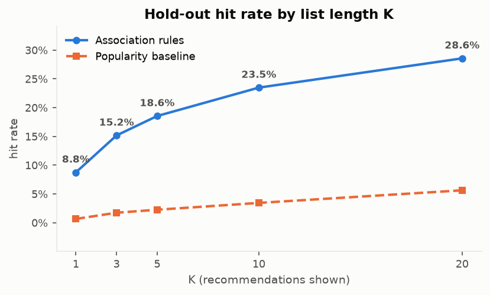
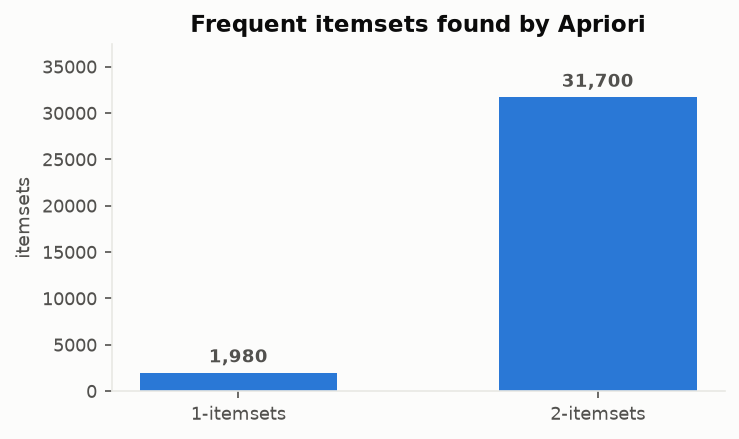
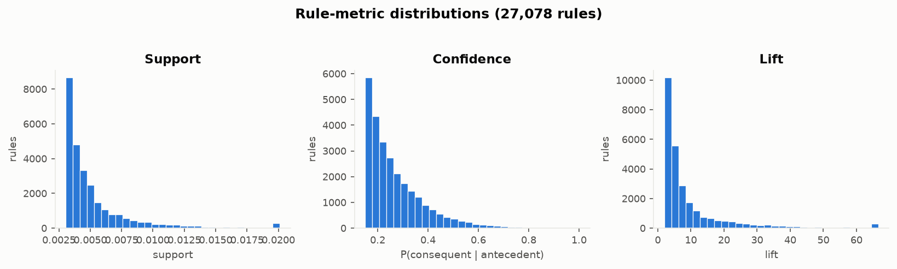
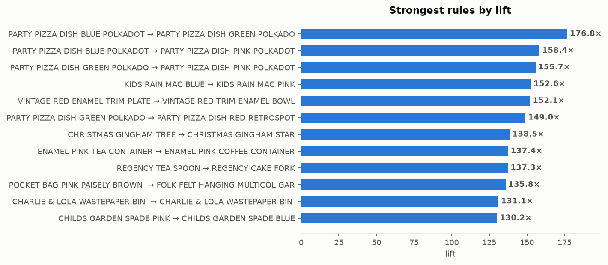
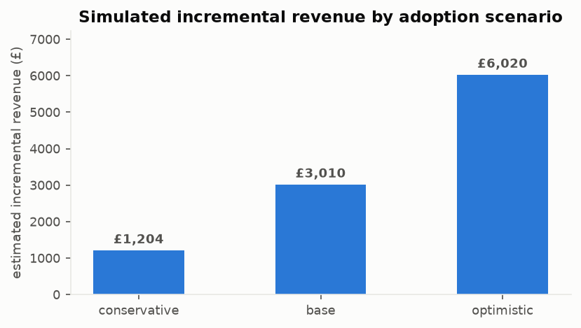

# Evaluation Report — Cross-Sell Recommendation Engine

**Rule set** `rs-43465a06-090dfeb4` · built 2026-11-15T20:36:42+00:00 · pipeline v1.0.0

**Dataset** `Online Retail.xlsx` (541,909 rows,
sha256 `43465a06f2ccf7c8…`)

> Association rules describe historical co-occurrence in this dataset. They are
> evidence for a merchandising decision, not a prediction that a customer will buy.
> Every revenue figure below is a simulation under stated assumptions, not measured uplift.

---

## 1. Headline results

| Metric | Value | Reading |
| --- | --- | --- |
| Rules generated | 27,078 | from 33,680 frequent itemsets |
| Hit rate @5 (hold-out) | **0.1855** | hidden product recovered in the top 5 |
| Popularity baseline | 0.0226 | "just show best-sellers" |
| Uplift vs baseline | **8.20×** | how much the rules beat popularity |
| MRR @5 | 0.1229 | mean reciprocal rank of the hidden product |
| Basket coverage | 97.9% | hold-out baskets that got a rule-based answer |
| Catalog coverage | 38.9% | products with at least one rule |

**Evaluation protocol.** The invoices are split chronologically. Rules are mined on
the first 70% of
invoices; thresholds were tuned on the validation slice; the figures above come from
the final slice, which the miner never saw. For each hold-out basket one product is
hidden at random (fixed seed), the engine recommends from the remaining products, and
we check whether the hidden product comes back in the top K.



---

## 2. Data preparation

| stage | rows_remaining | rows_removed |
| --- | --- | --- |
| raw input | 541,909 | 0 |
| drop exact duplicate rows | 536,641 | 5,268 |
| exclude cancellation invoices (C prefix) | 527,390 | 9,251 |
| require invoice/product/date/quantity/price | 527,390 | 0 |
| keep positive quantities | 526,054 | 1,336 |
| keep positive unit prices | 524,878 | 1,176 |
| drop non-product service codes | 522,537 | 2,341 |

Retained **96.4%** of raw rows
(522,537 of
541,909),
covering 19,773 invoices and
3,907 products.

### Splits

| split | invoices | products | mean basket | from | to |
| --- | --- | --- | --- | --- | --- |
| train | 12,779 | 3,229 | 26.9 | 2010-12-01 | 2011-09-27 |
| validation | 2,686 | 2,692 | 29.3 | 2011-09-27 | 2011-11-08 |
| test | 2,695 | 2,622 | 30.6 | 2011-11-08 | 2011-12-09 |

Products appearing in fewer than
5 training
invoices are excluded from mining — decided on the training window only, so the
hold-out cannot influence what the model is allowed to see.

---

## 3. Rule population

Mining configuration: `min_support=0.003`,
`min_confidence=0.15`, `min_lift=2.0`,
`min_antecedent_count=25`,
`max_itemset_size=2`, engine `builtin`
(mined in 2.64s).



### Distribution of the interest metrics

| metric | min | p25 | median | mean | p75 | p95 | max |
| --- | --- | --- | --- | --- | --- | --- | --- |
| support | 0.0031 | 0.0034 | 0.0042 | 0.0053 | 0.0057 | 0.0115 | 0.0506 |
| confidence | 0.1500 | 0.1842 | 0.2349 | 0.2717 | 0.3228 | 0.5127 | 1.0000 |
| lift | 2.0004 | 3.3800 | 5.2310 | 10.0358 | 10.5416 | 34.3216 | 176.8108 |
| leverage | 0.0015 | 0.0028 | 0.0034 | 0.0042 | 0.0045 | 0.0089 | 0.0429 |





Only one direction of each pair is plotted: `A → B` and `B → A` always share a
lift value, so both directions would occupy the chart twice. Note what the very
highest lifts actually are — colour variants of the same item (pizza dishes,
rain macs). Statistically these are the strongest associations in the data, but
commercially they are **substitutes, not complements**: a merchandiser should
read them as "customers buy this range in multiples" rather than as an add-on
opportunity. This is exactly why lift is an admission filter here and confidence
drives the ranking.

### Threshold sweep (validation split)

Serving thresholds were chosen here, on validation; the hold-out numbers above were produced once, afterwards.

| min_confidence | min_lift | hit_rate_at_k | basket_coverage | mrr_at_k | precision_when_served | baskets_evaluated |
| --- | --- | --- | --- | --- | --- | --- |
| 0.1500 | 4.0000 | 0.1865 | 0.9754 | 0.1118 | 0.1912 | 2,686 |
| 0.2000 | 4.0000 | 0.1865 | 0.9743 | 0.1118 | 0.1914 | 2,686 |
| 0.2500 | 4.0000 | 0.1847 | 0.9665 | 0.1114 | 0.1911 | 2,686 |
| 0.1500 | 2.0000 | 0.1843 | 0.9788 | 0.1105 | 0.1883 | 2,686 |
| 0.2000 | 2.0000 | 0.1839 | 0.9780 | 0.1105 | 0.1880 | 2,686 |
| 0.2000 | 3.0000 | 0.1839 | 0.9773 | 0.1102 | 0.1882 | 2,686 |
| 0.1500 | 3.0000 | 0.1839 | 0.9780 | 0.1102 | 0.1880 | 2,686 |
| 0.2500 | 3.0000 | 0.1835 | 0.9710 | 0.1101 | 0.1890 | 2,686 |
| 0.2500 | 2.0000 | 0.1832 | 0.9736 | 0.1103 | 0.1881 | 2,686 |
| 0.3000 | 4.0000 | 0.1817 | 0.9587 | 0.1105 | 0.1895 | 2,686 |

One standard error on these hit rates is about **0.0075** (2,686 baskets), so the top rows are statistically indistinguishable. The shipped configuration takes a row inside that band rather than the numerically largest one — chasing a difference smaller than the noise is how you overfit a validation split.

---

## 4. Revenue-impact simulation

Formula (PRD baseline):

```
expected additional orders    = eligible transactions × adoption rate
estimated incremental revenue = expected additional orders × average order value
```

| name | adoption_rate | eligible_transactions | expected_additional_orders | estimated_incremental_revenue |
| --- | --- | --- | --- | --- |
| conservative | 0.02 | 2,638 | 52.76 | 1,203.98 |
| base | 0.05 | 2,638 | 131.90 | 3,009.96 |
| optimistic | 0.10 | 2,638 | 263.80 | 6,019.92 |

Defaults derived from the hold-out window: eligible transactions = 2,695 test invoices x 97.9% basket coverage; average order value = support-weighted mean value of one purchase of a recommended product.



> **These are simulated planning estimates, not realised uplift.** They multiply
> assumptions the user supplies; establishing causal revenue impact requires a
> controlled live experiment, which is out of scope for this project.

---

## 5. Ranking policy

Recommendations are ranked by `confidence → lift → support`, top-5,
with `popularity` as the documented no-rule fallback.

`min_lift=2.0` is enforced as an admission filter, so every
served rule is already a genuine association; among those, confidence — P(B\|A) — is
what a top-K list should maximise. On validation this ordering retrieved the held-out
product noticeably more often than ranking by lift first.

---

## 6. Limitations

* One dataset: a UK gift wholesaler, Dec 2010 – Dec 2011. Seasonality is baked in.
* Returns, cancellations and zero-price lines are excluded from the baseline baskets;
  they remain in the raw file for a separate returns analysis.
* Rules are symmetric evidence of co-occurrence, not causation.
* Products below the support threshold have no rules and fall back to best-sellers,
  which is labelled as a fallback rather than given a fabricated confidence.
* Hit rate measures retrieval of a product the customer *did* buy; it cannot measure
  whether a recommendation would have *created* a purchase.

---

_Generated by `python -m crosssell.cli report`._
